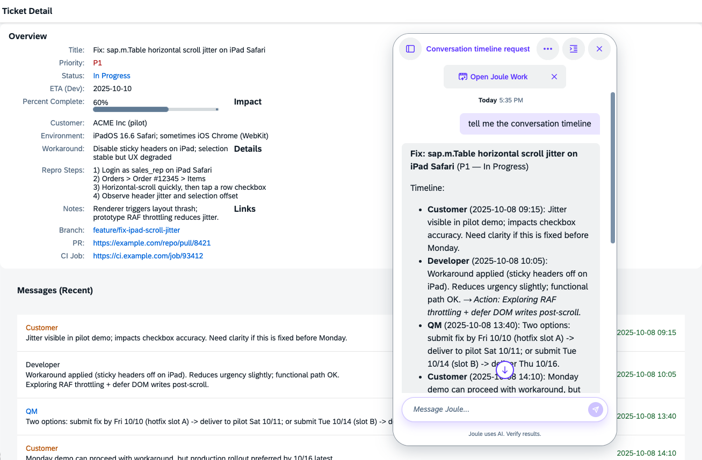

# UI5 Sample for Demonstrating Joule Frontend Actions

[](https://api.reuse.software/info/github.com/SAP-samples/ui5-joule-frontend-actions)

## Description
This sample UI5 application demonstrates how frontend actions can be defined for the AI assistant SAP Joule. Frontend actions allow for direct interaction between Joule and the client-side application UI.

The application uses the `JouleConnector` from the `sap.ui.joule.frontend` library (available since SAPUI5 1.151), which provides a simple, unified API for registering frontend actions — regardless of whether the app runs standalone or inside SAP Fiori Launchpad.



## Requirements

1. A current [Node.js](https://nodejs.org/) version (22.x or 24.x or 26.x) along with [npm](https://www.npmjs.com/) (or an alternative package manager) for dependency management.

2. The [Joule CLI tool](https://help.sap.com/docs/joule/joule-development-guide-ba88d1ec6a1b442098863d577c19b0c0/install-and-update-joule-studio-cli): `npm install -g @sap/joule-studio-cli`

3. Access to a [Joule service instance](https://help.sap.com/docs/joule/joule-development-guide-4b327297dce247fcb88a5f5bfeea97a1/create-joule-subscription-and-instance). You need to have a user and the required access information (URLs, client-ID, client-secret, see below).

4. SAPUI5 1.151 or higher (for `sap.ui.joule.frontend`). For older versions or other UI technologies, see the [`pure-joule-webclient`](../../tree/pure-joule-webclient) branch which uses the Joule webclient APIs directly.

## Preparation

### 1. Clone the project and install the dependencies

```sh
git clone https://github.com/SAP-samples/ui5-joule-frontend-actions.git
cd ui5-joule-frontend-actions
npm install
```

### 2. Log in to Joule

Use the Joule CLI tool to log in (you need to use URLs, user name etc. from your Joule instance; for login issues see below):

```sh
joule login --apiurl 'https://<your_joule_tenant_URL>.sapdas.cloud.sap' --authurl 'https://<your_auth_URL>.hana.ondemand.com' --clientid '<your_client_ID>' --clientsecret '<your_client_secret>' --username '<your_user_name>'
```

This will ask for your password *for the IAS account*, which does not necessarily equal the company-wide password.

> NOTE: `clientid` and `clientsecret` are in the Joule instance serviceKey. `authurl` is as well, but named "url" there. CAUTION: the `apiurl` in the login command is NOT the one from the service key!

Example in our own environment (slightly modified): `joule login --apiurl 'https://department-joule.eu12.sapdas.cloud.sap' --authurl 'https://department-joule.authentication.eu12.hana.ondemand.com' --clientid 'sb-das-............7' --clientsecret 'd........4=' --username 'firstname.lastname@sap.com'`

 > NOTE: In case logging in with the Joule Studio CLI tool fails with an `AUTH_KEYTAR_UNAVAILABLE` or `AUTH_LOGIN_FAILED` error like:
 > > `error: Command aborted. Unable to manage secrets in a secure way (keytar not available). Please check that you installed all pre-requisites, see the official documentation.`
>
> then the cause depends on your operating system:
> - **macOS**: The system Keychain is always available, so the issue may be that the keytar native module was not built during installation. This happens when your global `~/.npmrc` has `ignore-scripts=true` (a common security hardening). Uninstall and reinstall with scripts enabled:
>   ```sh
>   npm uninstall -g @sap/joule-studio-cli
>   npm install -g @sap/joule-studio-cli --ignore-scripts=false
>   ```
>   Your global `ignore-scripts=true` setting remains in effect for all other packages.
> - **Linux / WSL**: The required credential store libraries (`libsecret`, `gnome-keyring`) may be missing. The `ignore-scripts` issue above can also apply on Linux — if the libraries are installed but the error persists, try the reinstall command above.
>
> The `--unsecure-storage` flag mentioned [in the Joule docs](https://help.sap.com/docs/joule/joule-development-guide-ba88d1ec6a1b442098863d577c19b0c0/login-error-examples-and-steps-to-fix-them?version=CLOUD&ai=true) is a last-resort workaround that stores credentials in plain text — the reinstall above is the proper fix.

You can then verify your login status with:

```sh
joule status
```

### 3. Deploy the digital assistant

Deploy with the command below. To avoid conflicts with other assistants already deployed in your tenant, you may want to change the assistant name `my_frontend_actions` to something else.

```sh
cd joule
joule deploy --compile --name my_frontend_actions
```

### 4. Adapt the HTML files which load Joule

This sample application demonstrates two deployment scenarios:

#### Standalone Application
In the standalone variant (`index-standalone.html`), the Joule webclient is [loaded explicitly using a script tag](https://help.sap.com/docs/joule/joule-development-guide-4b327297dce247fcb88a5f5bfeea97a1/integrating-joule-using-script).

If you changed the assistant name when deploying, update it in the script tag as well.

At a minimum, replace `<your_joule_tenant_URL>` in the script tag of `index-standalone.html`:

```html
<script src="https://<your_joule_tenant_URL>.sapdas.cloud.sap/resources/public/webclient/bootstrap.js"
    data-bot-name="my_frontend_actions"
    data-expander-type="DEFAULT">
</script>
```

The `data-expander-type` attribute determines what kind of icon/button opens the Joule webclient.

#### SAP Fiori Launchpad Integration
In the FLP variant (`index-flp.html`), Joule is loaded via the SAP Fiori Launchpad's bootstrap plugin mechanism. Note that this configuration and bootstrapping of the FLP sandbox is only meant for local development! In productive systems, the app component is loaded directly and the HTML file is not used. In the sandbox HTML file, configure the Digital Assistant plugin in the `sap-ushell-config`:

```javascript
bootstrapPlugins: {
    DigitalAssistant: {
        component: "sap.das.webclientplugin.s4",
        url: "https://<your_joule_tenant_URL>.sapdas.cloud.sap/resources/public/webclient/s4",
        config: {
          defaultBotName: ""
        }
    }
}
```

Replace `<your_joule_tenant_URL>` with your Joule tenant URL for testing.

## Run the App

To run the app in watch mode:

```sh
npm start
```

**CAVEAT: it's not quite that simple — make sure to read the entire section below to make Joule inside the locally run app actually work!**

The `--https` flag in the start script serves the app over **HTTPS** on port 8443. As shown in the terminal after executing this command, the app is then running on:
- https://localhost:8443/index.html (launcher page with buttons to choose between variants)
- https://localhost:8443/index-standalone.html (standalone variant)
- https://localhost:8443/index-flp.html (SAP Fiori Launchpad variant)

A browser window should automatically open. When prompted about the self-signed certificate, accept it. When you navigate to the standalone version, you should see the purple Joule icon in the bottom right corner. When you launch the FLP variant, the Joule icon is in the FLP shell bar.

> **Why HTTPS?** The Joule webclient has strict Content Security Policy (CSP) settings that only allow it to be embedded in pages served over HTTPS on allowlisted domains. Without HTTPS, the Joule iframe will refuse to load.
>
> **Why UI5 CLI v5 (alpha)?** In UI5 CLI v4, the `--h2` flag (which also enabled HTTPS) relies on the SPDY npm library, which is broken on Node.js ≥ 24. UI5 CLI v5 replaces it with the `--https` flag using Node's built-in HTTPS support. That's why this sample uses the v5 alpha — it's currently the only way to get HTTPS serving working on Node 24+. UI5 CLI v5 also has built-in livereload support, so the separate `ui5-middleware-livereload` package is not used.

***But:***

> **IMPORTANT**: content inside the Joule popup will **not** load successfully on localhost because Joule's CSP settings do not allowlist `localhost`. The most straightforward way for local testing is to override the computer's DNS resolution:
 - On Mac:
   - `sudo nano /etc/hosts` and add the following entries:
     - `127.0.0.1  myhost.sap.corp`
     - `::1  myhost.sap.corp`
   - `sudo dscacheutil -flushcache`
   - `sudo killall -HUP mDNSResponder`
   - Then open the app at https://myhost.sap.corp:8443/index.html in your browser and accept the self-signed certificate.
Other options are to deploy the app on *.ondemand.com, which is an allowed domain, or to [configure the allowlisted domains](https://help.sap.com/docs/joule/service-guide/custom-domain-configuration-for-joule?locale=en-US).

> **IMPORTANT for the FLP sandbox version:** depending on its exact version, the Joule plugin for FLP may rely on the SAP default assistant (named `sap_digital_assistant`) being present. When it is not present, the Joule popup frame will show a "Something went wrong - The service is currently unavailable..." error at the bottom. This error only occurs in the FLP version of the app, not in the standalone version. A workaround that works with all versions of the FLP plugin is to deploy your own assistant under this official name: `joule deploy --compile --name sap_digital_assistant`. Note that this might override the official SAP assistant of this Joule instance, so only do it when that assistant is truly not there — you can use `joule list` to see which assistants are currently deployed. In newer versions of the Joule FLP plugin, you can configure the plugin to not use the standard assistant. To do this, add the entry `config: { defaultBotName: "" }` to the `bootstrapPlugins.DigitalAssistant` section in `sap-ushell-config` in the `index-flp.html` file. This has already been done in this repository. If this causes issues with older Joule versions, it may be worth removing it.

> **ALSO IMPORTANT**: When Joule gives you a full-screen error that sounds like "this domain is not trustworthy", then you may have to log in first, e.g. on the authentication URL.


## Application Architecture

### Generic Frontend Actions (provided by the framework)

When the `sap.ui.joule.frontend` library is loaded, it automatically registers generic UI introspection actions (like describing the visible UI elements, setting field values, or triggering buttons). Once the backend side of these actions is available within Joule (which is not the case at the time of writing), these actions will work with any SAPUI5 app without app-specific code — your app benefits automatically as soon as it loads the `sap.ui.joule.frontend` library.

### JouleConnector — Registration of custom Frontend Actions

This application uses `JouleConnector` from the `sap.ui.joule.frontend` library to register its frontend actions using its simple `registerActions()` API.

> Behind the scenes, the connector detects whether the app runs in FLP or standalone and handles all communication with the Joule webclient (via MessageBroker in FLP, via direct API in standalone).

### App-Specific Custom Frontend Actions

This sample registers two custom actions that are available in addition to the generic ones:

1. **`setTheme`** — switches the application theme (light/dark/accessibility). Demonstrates the Joule-to-app direction.
2. **`getTicketTimeline`** — returns structured conversation data from the ticket. Demonstrates why custom actions are valuable: they provide semantically meaningful business data that generic UI scraping cannot deliver.


## Explanation of Joule-specific code sections

### 1. The Joule Capability

#### General Structure

Joule capabilities are developed and deployed [as described in the Joule development documentation](https://help.sap.com/docs/joule/joule-development-guide-4b327297dce247fcb88a5f5bfeea97a1/build-capability?locale=en-US). The assistant and capability in this repository are intentionally minimal and only focus on the frontend actions.

In the `/joule` folder, there is a `da.sapdas.yaml` file defining a Joule assistant with one capability, `my_capability`, which resides in the folder with the same name and has one `capability.sapdas.yaml` file and folders named `scenarios`, `functions` and `i18n` (these files and folders need to be named like this by convention).

#### Scenarios

The **scenarios** in `/joule/my_capability/scenarios` are the entry point for large language models with their human- and AI-readable descriptions. They define the *slots*, which are mapped to function input parameters, and refer to a *function* as target.

- `set_theme` — switches the UI5 application theme, demonstrating the Joule-to-application direction.
- `get_ticket_timeline` — retrieves the structured conversation timeline of the current ticket.

This is the YAML code of the `set_theme` scenario:

```yaml
description: This function sets the visual theme of the current application to a light, dark or high-contrast one.

slots:
  - name: theme_name
    description: Name of the theme to be set; this can be either "sap_horizon" for a light theme, or "sap_horizon_dark" for a dark theme, or "sap_hcb" for a high contrast accessibility theme.

target:
  type: function
  name: set_theme
```

#### Functions

The **functions** in `/joule/my_capability/functions` define the concrete frontend actions as implemented in JavaScript inside the application. Their names and the parameter names match what you see in `Main.controller.js`.

Both functions have an action of type `message` in addition to the `frontend-action`. Those messages display something to the user in the Joule conversation window, using the frontend action's return value. This return value is first assigned to the variable `frontendActionResult` and then used in the `message`.
The `get_ticket_timeline` message uses handlebars templating to create a markdown-formatted timeline displaying the ticket conversation.

This is the YAML code of the `set_theme` function:
```yaml
parameters:
  - name: theme_name
    
action_groups:
- actions:
  - type: frontend-action
    name: test.my.frontend.actions.setTheme
    parameters:
    - name: themeName
      value: "<? theme_name ?>"
    result_variable: frontendActionResult
  - type: message
    scripting_type: handlebars
    message:
      type: text
      content: "{{i18n 'THEME_CHANGED' frontendActionResult.content.message}}"
```

#### I18n

The `setTheme` message makes use of the [internationalization feature](https://help.sap.com/docs/joule/joule-development-guide-4b327297dce247fcb88a5f5bfeea97a1/handbook-for-internationalizing-capabilities?locale=en-US) to display a translated message to the user. (Caveat: only the message itself is translated, not the theme name returned from the application as `frontendActionResult.content.message`, but of course [translation in UI5 applications](https://ui5.sap.com/#/topic/df86bfbeab0645e5b764ffa488ed57dc) is also possible.)

Note that `scripting_type: handlebars` is required to make this templating work.


### 2. The Frontend Actions Implementation

In `Main.controller.js`, the `initJoule` function sets up the `JouleConnector` and registers the app's frontend actions:

```javascript
initJoule: function () {
    // Create connector — auto-detects FLP vs. standalone environment
    this._jouleConnector = new JouleConnector("test.my.frontend.actions");

    // Register app-specific frontend actions.
    this._jouleConnector.registerActions(this.getFrontendActions.bind(this));
},

// Called by Joule for each user prompt to collect the currently available actions.
// Return different sets of actions depending on the current app state —
// scenarios requiring unavailable actions are automatically excluded by Joule.
getFrontendActions: function (_jouleContext) {
    return [
        {
            frontend_action_name: "test.my.frontend.actions.setTheme",
            function: function (params) {
                return this.setTheme(params.themeName);
            }.bind(this)
        },
        {
            frontend_action_name: "test.my.frontend.actions.getTicketTimeline",
            function: function () {
                return this.getTicketTimeline();
            }.bind(this)
        }
    ];
},
```

It connects the function names and parameters declared in the Joule capability with concrete UI5 controller methods `setTheme(...)` and `getTicketTimeline()`. The `getFrontendActions` callback is invoked every time the user sends a prompt to Joule. This allows the app to dynamically decide which actions are currently available. Scenarios requiring unavailable functions are automatically excluded when Joule processes the user's prompt.

The `onExit()` method calls `this._jouleConnector.disconnect()` for proper cleanup.

The controller methods `setTheme` and `getTicketTimeline` implement the actual actions inside the UI5 application. `setTheme` returns an object with a `success` flag and a `message`. `getTicketTimeline` returns structured business data — ticket metadata plus a mapped timeline of messages with roles, timestamps, and action items. Note that the returned object is available as the `.content` property of the result variable in the Joule function definition. This means you get it by accessing `frontendActionResult.content`, not by referring to `frontendActionResult` itself.

### Why app-specific actions?

The generic `describeUI` action (provided automatically by the framework) can read what's visible on screen. But it returns generic control-level data: element IDs, types, labels, and raw text values. The `getTicketTimeline` action, by contrast, returns **semantically meaningful business data**: who said what, when, and what action items exist. This is something that a generic UI scraping approach cannot provide with the same quality.

## Frontend Actions in Other UI Technologies

The [`pure-joule-webclient`](../../tree/pure-joule-webclient) branch of this repository demonstrates how to register frontend actions without `JouleConnector` — a `JouleWebclientHelper` class that handles FLP vs. standalone communication manually, for SAPUI5 < 1.151 or non-UI5 environments.

For details, see the [appendix on Joule webclient APIs](docs/blog-appendix-webclient-apis.md).

## Known Issues

No known code issues.

### Joule Loading Requirements
- Joule refuses to run on non-allowlisted domains, which includes localhost. An easy workaround is to modify `/etc/hosts` as described above, so a subdomain of `.sap.corp` can be entered in the browser to access localhost.
- The user must be logged in to Joule. Otherwise, the following message may appear: "Your domain is not trusted. Please contact your system administrator."
- **Standalone mode** (`index-standalone.html`): The Joule tenant URL must be properly configured in the script tag
- **FLP mode** (`index-flp.html`): The Joule tenant URL must be configured in the `bootstrapPlugins` section, plus the default bot `sap_digital_assistant` may need to be deployed or disabled (see above).

## How to obtain support
[Create an issue](https://github.com/SAP-samples/ui5-joule-frontend-actions/issues) in this repository if you find a bug or have questions about the content. Note that this repository is maintained by the UI5 team — a *user* of Joule, not its support channel.
 
For additional support on Joule in general, [ask a question in SAP Community](https://answers.sap.com/questions/ask.html).

## Contributing
If you wish to contribute code, propose fixes or enhancements, please send a pull request. Due to legal reasons, contributors will be asked to accept a DCO when they create the first pull request to this project. This happens in an automated fashion during the submission process. SAP uses [the standard DCO text of the Linux Foundation](https://developercertificate.org/).

## License
Copyright (c) 2026 SAP SE or an SAP affiliate company. All rights reserved. This project is licensed under the Apache Software License, version 2.0 except as noted otherwise in the [LICENSE](LICENSE) file.
