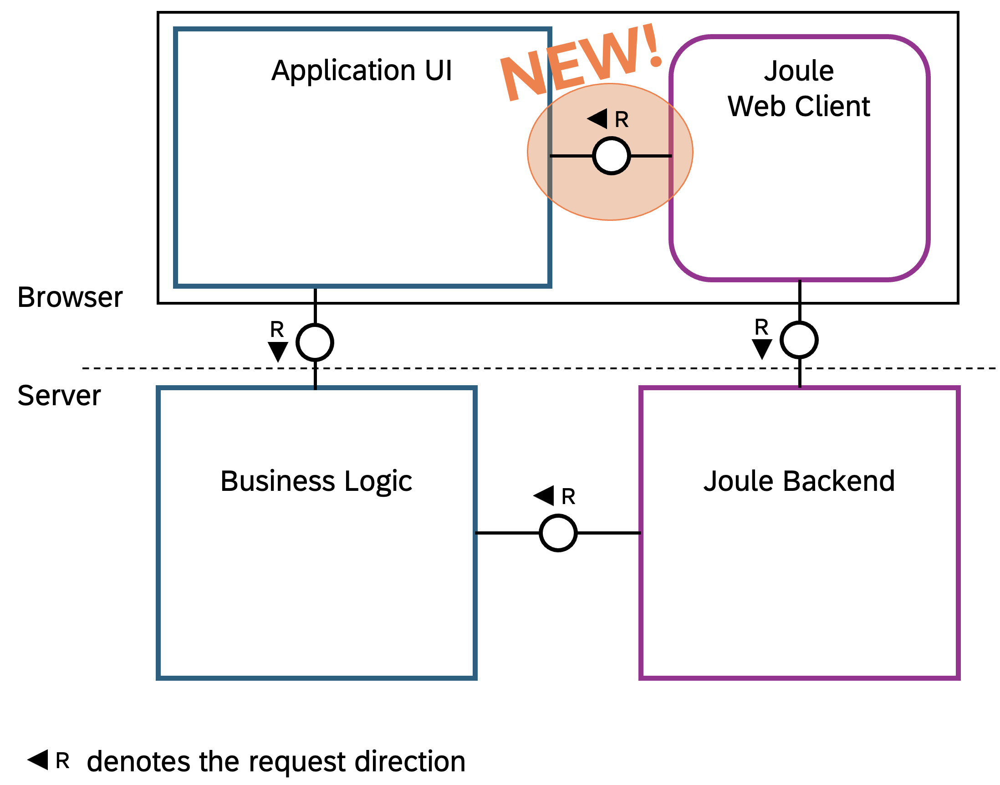
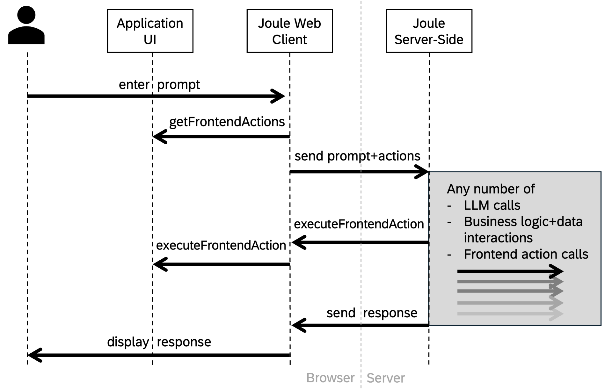
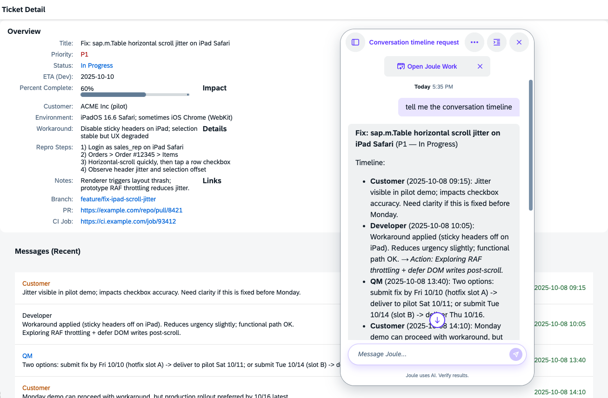

# Joule Frontend Actions – Let SAP's AI Assistant Talk to Your Application UI in SAPUI5 and Beyond

Joule – SAP's AI assistant for end users – has been tightly integrated with backend functionality, but now it's also talking to the application UI – right inside your browser.

> NOTE: This document explains the current state as of October 2026. The SAPUI5 `sap.ui.joule.frontend` library (including `JouleConnector`) is available in experimental state since SAPUI5 1.151. This project uses the current version 1.153.0.
>
> The Joule CLI is released via npm as [`@sap/joule-studio-cli`](https://www.npmjs.com/package/@sap/joule-studio-cli).

## What's new?

The Joule team has brought "Frontend Actions" to Joule. Frontend actions are functionality which the UI can offer to Joule, so this assistant can respond to the user's requests even better.

We, developing SAP's UI technologies, are excited to make use of those, to let Joule capability developers interact directly with the user interfaces, no matter whether they're using SAPUI5, SAP Fiori elements, SAP GUI for HTML/SAP GUI for Windows, Web Dynpro,...

Both, the UI frameworks but also specific applications (including your own app), can offer such actions. With those actions, Joule's capabilities can be more user-focused, more specific, and more interactive now.



## What's in it for me?

- As an end-user, you will get better responses from Joule and have it work more directly with the apps you are using.
- As an app developer, you can now make your app more accessible to Joule and provide a better user experience.
- As a Joule scenario developer, you will have more tools at hand to provide even more intelligent and interactive AI actions.

## How does it work?

You define an action's purpose, input parameters, and response in a YAML file and deploy it to Joule, so the LLM (Large Language Model) powering Joule can make sense of it and decide whether invoking the action would help with responding to the user's request. Inside the browser, a new communication channel between Joule's web client (the UI of Joule) and the web page (running any app or framework) is established. This communication allows Joule to check for currently available actions and to invoke a specific action – basically any kind of JavaScript function – and read its result.

The overall flow from the user entering a prompt to the response from Joule being displayed looks like this:



The action could be anything, not only reading information like the currently displayed data or error messages in the UI, but also modifying data, filters, sorting, personalization, or even navigating through the app or between apps.

A simple showcase, for which example code will be shown, allows Joule to retrieve the timeline of messages in an SAPUI5 application dealing with customer tickets:



In a sense, this is similar to how MCP (Model Context Protocol) servers allow an AI tool to interact with coding projects or anything else in the real world, like home automation tools or weather stations. Only the protocol is different because the way an MCP client and server interact does not work within a browser window and no alternative for this scenario has emerged yet.

Frontend actions can become available and unavailable dynamically. After each user prompt, the UI is asked for the currently available actions. This allows implementing actions which only make sense in particular circumstances. Any scenarios requiring an action that is currently *not* available will not be selected by Joule. When you navigate in an application and interact with different views and view states, the list of frontend actions will thus always match what is currently available in the UI.

## In very simple terms: What is Joule?

If you are not familiar with Joule from a development perspective, it's a cloud service, which integrates with the BTP platform and for which capabilities can be developed. The developer defines an assistant with such capabilities. One capability is a group of semantically related use-cases, so-called scenarios. The scenarios have a human-readable – pardon: LLM-readable – description of what they do and what input parameters they need. The scenarios typically have a function as target. All the mentioned artifacts are technically described in YAML files.

For the end-user, the Joule web client can appear as a chat frame inside applications to assist users. The LLM powering it can choose to invoke the available scenarios during the conversation.

Further info: https://www.sap.com/products/artificial-intelligence/ai-assistant.html

## How do I offer Frontend Actions in my app?

At https://github.com/SAP-samples/ui5-joule-frontend-actions we have provided an example app, with the key parts explained in this blog post. We use SAPUI5 as example environment, but some parts apply to all UI technologies. Overall, two things are needed:

1. The Joule scenario/function definition, deployed to the Joule backend
2. The function implementation and registration inside the browser

Why is it required to deploy the function definition ahead of time although the UI can dynamically declare which actions are available as the user enters prompts at runtime? Because Joule needs to pre-process/vectorize the action descriptions in order to discover related actions for a prompt by using similarity search.

### 1. Define the action and deploy the definition to Joule

The technical "API" (name, parameters, result) of the frontend action needs to be defined in a \*.yaml file, as [documented by the Joule team](https://help.sap.com/docs/joule/joule-development-guide-ba88d1ec6a1b442098863d577c19b0c0/action-group-70e471d4234b41e6b9b2b049fb0b514a?locale=en-US#loio70e471d4234b41e6b9b2b049fb0b514a__subsectiontitle_n2w_1ys_pgc).

Here's a simple example – setting the visual theme of the application. Admittedly, this is not very application-specific and could rather be a framework-level action, but it is a visually nice and simple example:

```yaml
action_groups:
- actions:
  - type: frontend-action
    name: test.my.frontend.actions.setTheme
    parameters:
    - name: themeName
      value: "<? theme_name ?>"
    result_variable: frontendActionResult
  - type: message
    scripting_type: handlebars
    message:
      type: text
      content: "{{i18n 'THEME_CHANGED' frontendActionResult.content.message}}"
```

And a more complex example – retrieving the structured ticket conversation timeline:

```yaml
action_groups:
- actions:
  - type: frontend-action
    name: test.my.frontend.actions.getTicketTimeline
    result_variable: frontendActionResult
  - type: message
    scripting_type: handlebars
    message:
      type: text
      markdown: true
      content: |
        **{{frontendActionResult.content.ticketTitle}}** ({{frontendActionResult.content.priority}} — {{frontendActionResult.content.status}})

        Timeline:
        {{#each frontendActionResult.content.timeline}}
        - **{{role}}** ({{timestamp}}): {{message}}{{#if actionItem}} _→ Action: {{actionItem}}_{{/if}}
        {{/each}}
```

Those actions, however, are not directly offered to Joule, but they are rather part of a scenario. (In this respect, this article has so far simplified some details.) Only the scenario is what Joule can actually see and invoke. But of course, a scenario can consist of exactly one frontend action if no additional steps are needed.

```yaml
description: >-
  This function retrieves the conversation timeline of the currently displayed support ticket,
  including all messages from customers, developers, and QA with their timestamps and action items.
  Use this when the user asks about the ticket history, latest updates, what someone said,
  or action items on the ticket.

target:
  type: function
  name: get_ticket_timeline
```

As mentioned, Joule can only see and use those scenarios where all mandatory actions are currently available.

Further YAML files define the capability containing the scenarios and the overall "assistant". All those YAML files are in the [sample app in this "joule" folder](https://github.com/SAP-samples/ui5-joule-frontend-actions/tree/main/joule) and need to be deployed using the [Joule CLI tool](https://help.sap.com/docs/joule/joule-development-guide-ba88d1ec6a1b442098863d577c19b0c0/install-and-update-joule-studio-cli).

Prerequisite for this is a Joule tenant and access credentials. How this can be set up on server side is described [here](https://help.sap.com/docs/joule/joule-development-guide-4b327297dce247fcb88a5f5bfeea97a1/create-joule-subscription-and-instance).

First you log in (you can check the status with `joule status` afterwards), then you deploy (Caution: you need to execute the deploy command inside the `joule` directory!):

```sh
joule login --apiurl 'https://<your_das_tenant_URL>.sapdas.cloud.sap' --authurl 'https://<your_auth_URL>.hana.ondemand.com' --clientid '<your_client_ID>' --clientsecret '<your_client_secret>' --username '<your_user_name>'

joule deploy --compile --name my_frontend_actions
```

### 2. Implement the action and register it with JouleConnector

Since SAPUI5 1.151, the `sap.ui.joule.frontend` library provides the `JouleConnector` class which handles all communication with the Joule web client. It auto-detects whether the app runs standalone or inside SAP Fiori Launchpad and uses the appropriate communication mechanism internally.

Here is the complete setup in your controller:

```javascript
sap.ui.define([
    "sap/ui/core/mvc/Controller",
    "sap/ui/core/Theming",
    "sap/ui/joule/frontend/JouleConnector"
], function (Controller, Theming, JouleConnector) {
    "use strict";

    return Controller.extend("my.app.controller.Main", {
        onInit: function () {
            // ... load models ...
            this.initJoule();
        },

        initJoule: function () {
            // Create connector — auto-detects FLP vs. standalone
            this._jouleConnector = new JouleConnector("my.app.namespace");

            // Register app-specific frontend actions
            this._jouleConnector.registerActions(this.getFrontendActions.bind(this));
        },

        // Called by Joule for each user prompt to collect the currently available actions.
        // Return different sets of actions depending on the current app state —
        // scenarios requiring unavailable actions are automatically excluded by Joule.
        getFrontendActions: function (_jouleContext) {
            var that = this;
            return [
                {
                    frontend_action_name: "my.app.setTheme",
                    function: async function (params) {
                        return that.setTheme(params.themeName);
                    }
                },
                {
                    frontend_action_name: "my.app.getTicketTimeline",
                    function: async function () {
                        return that.getTicketTimeline();
                    }
                }
            ];
        },

        onExit: function () {
            if (this._jouleConnector) {
                this._jouleConnector.disconnect();
            }
        },

        // ... action implementations ...
    });
});
```

That's it.

> Note: the action function should do its task reasonably fast – just like it would do for a user interaction in the UI. There is currently a 15‑second timeout to prevent Joule from having to wait too long.

The `getFrontendActions` method is invoked for each user prompt, so you can dynamically return different actions depending on the current UI state.

When parameters are declared in the YAML action definition (like `themeName` for `setTheme`), the JavaScript function is called with those parameters set by Joule:

```javascript
{
    frontend_action_name: "my.app.setTheme",
    function: async function (params) {
        const { themeName } = params;
        Theming.setTheme(themeName);
        return { success: true, message: "Theme changed" };
    }
}
```

### Why app-specific actions?

The SAPUI5 framework automatically registers generic actions (like `describeUI`, `setFields`, `executeAction`) that work with any SAPUI5 application without a single line of app code - as soon as the new `sap.ui.joule.frontend` library is loaded and Joule gets those generic actions deployed. These allow Joule to read visible UI elements and interact with controls generically.

But generic actions return generic data: element IDs, types, labels, raw text values. This might be sufficient for knowing enough about the UI for certain activities, but app-specific actions can return **semantically meaningful business data**.

Consider the difference for our ticket timeline:
- **Generic `describeUI`**: returns a full structure of the UI tree. All the data is there, but it's complex and the relevant data needs to be figured out.
- **App-specific `getTicketTimeline`**: returns a very specific, tailored data structure: `{role: "Customer", timestamp: "2025-10-08 09:15", message: "Jitter visible...", actionItem: null}`.

The app-specific version gives Joule **context and semantics** — who said what, when, and what action items exist. This enables Joule to answer questions like "What did the customer say?" or "What's the latest update?" much better without parsing UI control labels.

Both types coexist: the generic actions run under a framework-managed client ID, your app-specific actions under your own. Joule sees and can use both.

### Generic actions — what you get for free

Simply loading the new `sap.ui.joule.frontend` library automatically registers four generic UI introspection/manipulation actions:

| Generic Action | What it does |
|---|---|
| `describeUI` | Returns a hierarchical tree of the visible UI with types, labels, values |
| `describeUIElement` | Describes a single element in detail by its control ID |
| `setFields` | Sets one or more field values and updates model bindings |
| `executeAction` | Presses a button, clicks a link, or triggers an action on a control |

These generic actions work with any SAPUI5 application without a single line of app code. If you only need Joule to read and interact with whatever is on screen generically, just load the library and you're done.

> CAVEAT: this is only true once the respective actions are also deployed to the Joule backend by default, which is not yet the case at the time of writing.

If the app runs standalone and wants to embed the Joule webclient chat overlay, it also needs to load Joule by including its bootstrap.js file. The `data-bot-name` must be the name used when deploying the Joule assistant.

```html
<script src="https://<your_das_tenant_URL>.sapdas.cloud.sap/resources/public/webclient/bootstrap.js"
   data-bot-name="my_frontend_actions"
   data-expander-type="DEFAULT">
</script>
```

## How do SAP's UI technologies use it?

The feature is new and we are still exploring the options for generic functionality we can provide. The generic actions have already been mentioned above and those are not a SAPUI5-only thing! They are being implemented across technologies, so Joule can talk to UIs regardless of the UI technology used.

When it comes to further framework-level actions, the more higher-level and guard-railed a framework, the more higher-level and powerful can the provided actions be.

In the area of **SAP Fiori elements**, potential use cases could include generically enabling features that are already available within Fiori elements applications. For instance, a context-specific request such as "Summarize this" could trigger the AI-assisted Smart Summarization capability while the user is viewing a specific business object. Furthermore, by utilizing metadata-driven building blocks—which interpret the semantics exposed via OData services—frontend functions could open opportunities to deliver context-aware value.
When it comes to app-specific frontend actions, a promising direction could be to enable developers to supply these via a dedicated controller extension—like how a custom app context object can already be provided to Joule.

In the area of **SAPUI5**, the generic actions already available (describeUI, setFields, executeAction, describeUIElement) cover a wide range of use cases out of the box. The `JouleConnector` makes it straightforward for applications to add their own domain-specific actions on top.

For **UI5 Web Components**, which are lower-level, without a dedicated framework, provisioning meaningful actions may be harder, but could be related to the more powerful components.

Classic UIs (SAP GUI for HTML and Web Dynpro for ABAP) will also be supported, with a pragmatic approach that reflects their typical lifecycle and architecture:

- **SAP GUI for HTML**: generic support

  - For SAP GUI for HTML applications the offering will be generic and lightweight: actions to read the current screen state, extract visible fields and tables, perform simple updates or simulate common user commands.
  - This keeps integration low-effort for long-maintained applications while still enabling valuable Joule-driven scenarios.

- **Web Dynpro for ABAP**: generic + extensible

  - Web Dynpro will provide the same set of useful generic frontend actions
  - Additionally, Web Dynpro will allow developers to register application-specific frontend actions implemented in ABAP, so richer, domain-aware interactions are possible where needed. The transportation management cockpit will be the first consumer of Web Dynpro Joule frontend actions, demonstrating how app-specific ABAP actions can unlock richer AI-driven scenarios.

- **SAP GUI for Windows**: generic approach

  - The generic feature set planned for SAP GUI for HTML is intended to be available for SAP GUI for Windows transactions as well.

  - Important: Joule integration and Frontend Actions are only supported if SAP GUI for Windows is run within SAP Business Client.

Which generic Joule frontend actions would you like to see provided by your favorite SAP UI framework? What do you think would make Joule more powerful?
Let us know below!

---

> **Note for SAPUI5 versions before 1.151** or non-UI5 environments: the `JouleConnector` is not available. In that case, you can communicate with the Joule web client directly using its JavaScript APIs. This involves handling FLP vs. standalone detection yourself. See the [appendix on direct webclient usage](blog-appendix-webclient-apis.md) for details and the [`pure-joule-webclient` branch](https://github.com/SAP-samples/ui5-joule-frontend-actions/tree/pure-joule-webclient) of the sample app for a complete working example.

*Article written with contributions from Christian Grail and Andriy Sobol (Classic UIs) and Christian Kolbowski (SAP Fiori elements).*
